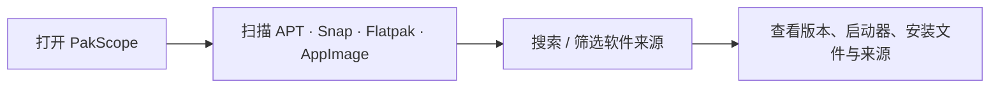

<div align="center">

# 📦 PakScope · 包览

### Ubuntu / GNOME 已安装软件管理与来源检查器

**电脑装了哪些应用？来自 APT、Snap、Flatpak 还是 AppImage？点开就能看清。**

*Lightweight Linux application inventory and package origin inspector, built with Rust + GTK4 / Libadwaita.*


**[⬇ 下载 Ubuntu amd64 预览包](https://github.com/lbg2002/pakscope/actions/runs/38252897483)** · [👀 界面预览](docs/UI_PREVIEW.html) · [✨ 功能说明](#-当前实现) · [🔧 本地构建](#-构建推荐-ubuntu-2604--gnome)

</div>

> **发布状态：** v0.1.1 已有 GitHub Actions 提供的 Ubuntu 构建包，但本仓库**暂未发布正式 GitHub Release**。下载入口位于 Actions 工作流的 Artifacts 区域，通常需要登录 GitHub，并可能在保留期后过期。当前版本**仅查看和导出，不会卸载、删除或自动清理任何软件**。

## 🧭 三步看清已安装应用



| 🔍 **一站式查看** | 🧭 **来源与详情** | 🔐 **安全只读** |
| :--- | :--- | :--- |
| 搜索已安装的桌面应用，按来源筛选 | 查看版本、安装文件、启动入口、包归属 | 完全本地运行，不要求 sudo，不会执行卸载 |
| 🪟 **GNOME 风格** | ⚡ **Rust 后台扫描** | 📤 **诊断与导出** |
| GTK4/Libadwaita、侧栏拖动、自适应详情面板 | 后台扫描可刷新，不阻塞界面 | 支持 JSON/TSV，便于记录软件环境 |

## ⬇️ 安装 Ubuntu 预览版

打开 [**Build and verify · 已通过构建**](https://github.com/lbg2002/pakscope/actions/runs/38252897483)，在页面底部 Artifacts 下载 **`pakscope-ubuntu-amd64-preview`**，解压后找到 `.deb`，在对应目录运行：

```bash
sudo apt install ./pakscope_*.deb
```

Ubuntu/GNOME 建议从应用菜单启动 PakScope，也可按下方源码构建说明运行。安装时 apt 可能需要系统 GTK4/Libadwaita 运行依赖；**应用本身无需管理员权限启动**。

**注意扫描范围：** PakScope 优先呈现具有桌面启动器的图形应用，不等同于列出 `dpkg -l` 中的全部系统包与驱动。源码中的 [交互设计预览](docs/UI_PREVIEW.html) 使用示例数据，不能代替实际运行截图。

## v0.1.1 界面与交互更新

- 左侧仅保留操作导航：已安装应用、重新扫描、导出 JSON、扫描诊断，以及底部设置；不再重复列出来源。
- GTK4 Paned 支持拖动左侧工具栏宽度；移除欢迎横幅、占位状态卡和永久解释文本。
- 搜索、来源筛选和排序集中在内容区；单击列表行或通过键盘激活均可展示详情。
- 详情位于右侧可关闭面板；窄窗口用独立详情窗口。包含复制路径、打开目录、查看 APT 文件清单。
- 左下角设置提供主题切换及恢复侧边栏宽度。扫描诊断和导出菜单可直接操作。
- APT/DEB 不再把通用 `/usr` 冒充真实安装目录：仅在能确定启动命令目标时展示执行文件路径，其他情况标注未确定。

## ✨ 当前实现

- 原生 GTK4 + libadwaita 界面：紧凑工具栏、圆角列表、彩色来源标签、浅/深色模式跟随 GNOME。
- 中文优先：统一软件列表、应用名称关键词搜索、软件来源过滤、右侧详情面板、复制路径、打开目录。
- APT/DEB：检查 `/usr/share/applications` 等目录中的 `.desktop` 文件，使用 `/var/lib/dpkg/info/*.list` 匹配文件所有者、`dpkg-query` 读取版本和包报告的安装大小。
- Snap：匹配 `snap list` 的安装记录与 `/var/lib/snapd/desktop/applications` 中可见的桌面启动器。
- Flatpak：读取 `flatpak list --app`。不含 runtimes。
- AppImage：**有限目录扫描** `$HOME/Applications`、`$HOME/应用程序`、`$HOME/.local/bin`、`$HOME/bin`；不会扫描整个磁盘，也不会执行未知文件。
- 不能确认包归属的 `.desktop` 文件标注「手动 / 未识别」，而非伪造 APT 来源。
- 非阻塞后台扫描：界面显示进度，并可主动刷新；**无常驻服务、无联网、无 sudo**。
- `pakscope-scan` 命令行支持 TSV 和 JSON 导出，便于诊断或记录系统环境。

### 注意识别范围

**图形应用 != 所有安装包**。APT 的大量库、驱动和系统依赖没有 `.desktop` 启动器，因此不会出现在普通应用列表中。以后增加独立的「系统包专家模式」，默认隐藏系统组件。**DEB 安装位置通常分散在 `/usr/bin`、`/usr/lib` 等目录，不是一个文件夹**；详情显示概略路径和桌面启动器，不能把这种概略路径当作可删除目录。Snap、Flatpak 的运行时/存储空间也不是简单相加的独立应用体积。某些 Snap 应用未提供桌面启动器，本版可能不列出。

## 🛠 构建（推荐 Ubuntu 26.04 / GNOME）

```bash
sudo apt update
sudo apt install build-essential pkg-config libgtk-4-dev libadwaita-1-dev libglib2.0-dev git curl
# 如果未安装 Rust，请参照 https://rustup.rs 安装稳定版工具链
cargo build --release
./target/release/pakscope
```

无需 root 启动程序。首次扫描可能需要一些时间，取决于 dpkg 软件包数量。

### CLI 运行 / 后端测试

初次编译会生成 `Cargo.lock`。作为应用项目，建议将该文件提交到 Git 仓库，确保后续构建版本可复现。


```bash
cargo test --no-default-features
cargo run --no-default-features --bin pakscope-scan -- --json > apps.json
cargo run --no-default-features --bin pakscope-scan -- > apps.tsv
```

### 制作 DEB

```bash
bash scripts/build-deb.sh
# 输出在 dist/pakscope_0.1.1_amd64.deb（以当前架构为准）
```

DEB **不会**捆绑 GTK 或 libadwaita 巨型运行库。依赖系统组件，以减小包体积。首次发行体积未实测，不能承诺特定 MB 数值。自建包在本地安装前请先测试：

```bash
sudo apt install ./dist/pakscope_0.1.1_$(dpkg --print-architecture).deb
```

## 🖥 界面预览

设计评审可以在浏览器打开 [`docs/UI_PREVIEW.html`](docs/UI_PREVIEW.html)，体验亮/暗色切换、左侧来源筛选、搜索与详情弹窗。**它使用示例数据，并非扫描后端；实际桌面界面基于 GTK4。**

## 🏗 技术结构

```text
src/scanner.rs         只读扫描器与基础测试（不依赖 GTK）
src/bin/pakscope-scan.rs  CLI / JSON
src/main.rs            原生桌面界面
assets/style.css       libadwaita 自适应主题样式
assets/*.svg           项目标识
scripts/build-deb.sh   本地 Debian 打包
.github/workflows/ci.yml  后端测试 + GUI 编译检查 + 可下载 DEB artifact
```

## 🧭 规划

- **v0.1**：只读清单、筛选、路径、基础应用详情、JSON 导出、打包、CI。
- **v0.2**：安全卸载：权限模型、包管理器原生模拟、影响清单、明确确认、操作日志、失败回滚指引（不声称能恢复任意删除）。
- **v0.3**：系统包专家模式、空间分析、AppImage 自定义目录、重复安装提示、残留检测（默认仅建议，不自动清除）。
- **v1.0**：国际化、无障碍、批量测试、ARM64 包、稳定发布。

## 🔐 安全与隐私

所有扫描在本机进行，不上传应用清单。当前版本没有网络客户端、遥测、账号机制、持续后台进程、特权守护进程、包删除逻辑。打开目录只调用 `xdg-open`，不会执行 `.desktop` 文件里的命令。

## 📄 许可证

MIT — 见 [LICENSE](LICENSE)。欢迎 Issue / PR。
